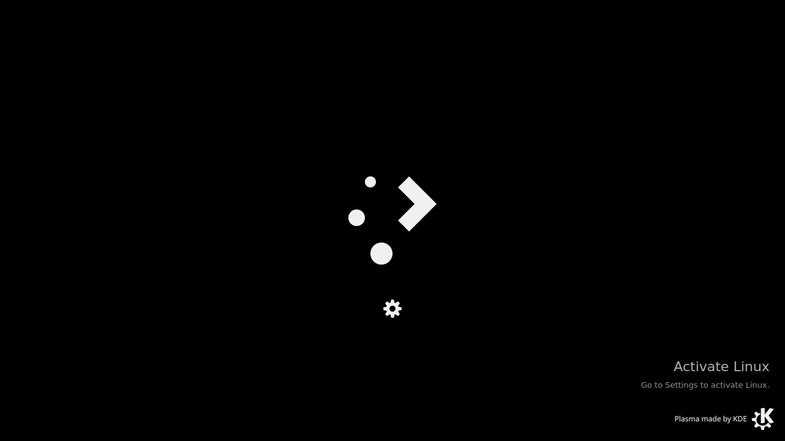

# Activate Linux

The iconic "Activate Windows" watermark, but for Linux. Because why not.



A floating, transparent, click-through overlay that sits in the bottom-right corner of your screen — just like the real thing.

## Features

- **Transparent** — only the text is visible, no background box
- **Click-through** — mouse events pass straight through to windows below
- **Always on top** — floats above all windows, just like Windows
- **Lightweight** — single Python script using PyQt5

## Requirements

- Python 3
- PyQt5
- X11 with a compositor (for transparency)

## Install

1. Install PyQt5:

   **Ubuntu/Debian:**
   ```bash
   sudo apt install python3-pyqt5
   ```

   **Arch:**
   ```bash
   sudo pacman -S python-pyqt5
   ```

   **Fedora:**
   ```bash
   sudo dnf install python3-qt5
   ```

   **Or via pip:**
   ```bash
   pip install PyQt5
   ```

2. Clone this repo:
   ```bash
   git clone https://github.com/frmdeveloper/activate-linux.git
   cd activate-linux
   ```

3. Run it:
   ```bash
   python3 activate-linux.py
   ```

### Autostart

To run automatically on login:

**KDE Plasma / GNOME / most desktops:**
```bash
mkdir -p ~/.config/autostart
cp activate-linux.desktop ~/.config/autostart/
```
Then edit `~/.config/autostart/activate-linux.desktop` and replace `/path/to/activate-linux.py` with the real path.

## Uninstall

1. Stop the running script:
   ```bash
   pkill -f activate-linux.py
   ```

2. Remove autostart (if you set it up):
   ```bash
   rm ~/.config/autostart/activate-linux.desktop
   ```

3. Delete the folder:
   ```bash
   rm -rf activate-linux
   ```

4. (Optional) Remove PyQt5 if nothing else uses it:
   ```bash
   sudo apt remove python3-pyqt5
   ```

## Customize

Edit the text, font size, color, or position directly in `activate-linux.py`:

```python
l1 = QLabel("Activate Linux")  # main text
l2 = QLabel("Go to Settings to activate Linux.")  # sub text
# ...
w.move(1280 - 320 - 25, 720 - 70 - 65)  # position (adjust for your resolution)
```

## License

MIT — do whatever you want with it.
